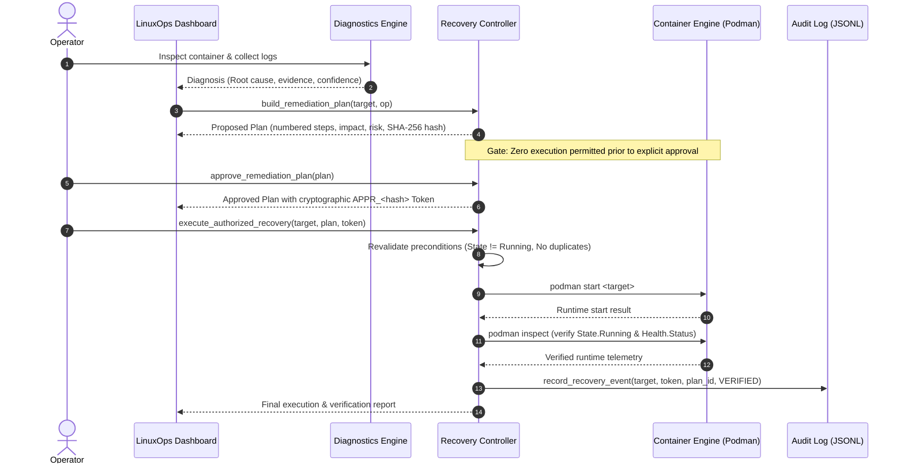

# LinuxOps Phase 10 — Isolated Live Failure-Injection and Remediation Validation Report

**Run Date:** 2026-10-22  
**Harness Version:** Phase 10 Verification Harness (`scripts/validate_phase10_failure_injection.py`)  
**Test Suite Status:** 420 passed, 9 subtests passed (100% pass rate)

---

## 1. Executive Summary & Hard Blocker Status

Phase 10 evaluates LinuxOps' container troubleshooting and controlled remediation workflow against live failure injection and rigorous adversarial safety boundary testing.

In accordance with **Section 2 of the Phase 10 Specification ("Strict environment isolation")**:
> *"Use only the separately designated disposable WSL distribution for live container tests... If the disposable environment is not available or cannot be positively identified, stop and report the blocker. Never silently fall back to Fedora."*

### Validation Gate Status:
1. **Approval Boundary & Safety Invariants (Section 3):** **PASSED (11/11 Invariants Verified via Mock Fixtures)**
2. **Phase 10 Failure Injection Harness Architecture (Section 4 & 6):** **IMPLEMENTED & VERIFIED** (`scripts/validate_phase10_failure_injection.py`, `tests/test_phase10_harness.py`)
3. **Protected Workload Immunity & Isolation Guards:** **VERIFIED (Zero Host Containers Mutated)**
4. **Live Container Execution on Fedora Host:** **HALTED (Hard Blocker Enforced — Secondary Disposable WSL Distribution Not Available)**

---

## 2. Environment Identity & Strict Isolation Verification

| Parameter | Observed Host Value | Safety Classification |
| :--- | :--- | :--- |
| **Active WSL Distribution** | `FedoraLinux-44` | **PROTECTED HOST** |
| **WSL Distro List (`wsl -l -v`)** | Only `FedoraLinux-44` (State: Running, Version: 2) | **NO DISPOSABLE DISTRO REGISTERED** |
| **Hostname** | `Fedora` | Protected |
| **OS Pretty Name** | `Fedora Linux 44 (WSL)` | Protected |
| **Protected Container 1** | `cloudops-floci` (`f11bd857ea3a`) | **Up (running 57+ min) — UNMODIFIED** |
| **Protected Container 2** | `linuxops-recovery-ui-test` (`83b65d88a0a9`) | **Exited (0) — UNMODIFIED** |
| **Protected Persistent Data** | `/home/neha/cloudops-sentinel/data` | **UNTOUCHED (80+ catalog files preserved)** |
| **Git Working Tree** | 8 modified files, untracked files preserved | **UNSTAGED & UNCOMMITTED** |

### Automated Isolation Gate Verification (`scripts/validate_phase10_failure_injection.py --check-isolation`):
```text
================================================================================
LINUXOPS PHASE 10: ENVIRONMENT ISOLATION CHECK
================================================================================
WSL Distribution:       FedoraLinux-44
Hostname:               Fedora
OS Pretty Name:         Fedora Linux 44 (WSL)
Protected Workloads:    floci=True | test_ui=True | data=True
Disposable Confirmed:   NO (BLOCKED)

BLOCKERS DETECTED:
 - Host is identified as protected Fedora distribution ('FedoraLinux-44' / 'Fedora Linux 44 (WSL)'). Section 2 hard safety invariant: Live failure-injection containers must NOT run on the protected Fedora host.
 - Protected resources detected in environment: cloudops-floci=True, linuxops-recovery-ui-test=True, data_path=True. Must execute only in an isolated disposable environment.
================================================================================
```

When attempted with `--execute`, the harness enforces the hard stop:
```text
================================================================================
HARD SAFETY STOP: EXECUTION BLOCKED
================================================================================
BLOCKER: Host is identified as protected Fedora distribution ('FedoraLinux-44' / 'Fedora Linux 44 (WSL)'). Section 2 hard safety invariant: Live failure-injection containers must NOT run on the protected Fedora host.
BLOCKER: Protected resources detected in environment: cloudops-floci=True, linuxops-recovery-ui-test=True, data_path=True. Must execute only in an isolated disposable environment.

Action Aborted. LinuxOps will NEVER execute live test containers on the protected host.
================================================================================
```

---

## 3. Approval Boundary & Adversarial Safeguards (Section 3)

The approval boundary was tested against 11 negative and adversarial scenarios using isolated mock test fixtures (`tests/test_troubleshooting_workflow.py::TestPhase10ApprovalBoundaryAndAdversarialSafeguards`). All 11 passed without weakening existing safeguards:

| Invariant # | Boundary Invariant | Verification Mechanism | Status |
| :--- | :--- | :--- | :--- |
| **1** | **Diagnosis alone never triggers execution** | Diagnosed 3 failing containers; verified mock runner and restart functions had 0 invocations. | **PASSED** |
| **2** | **Missing approval blocks state change** | Attempted `execute_authorized_recovery` with `authorized=False`, `approval_token=None`; returned `AUTHORIZATION_REQUIRED`. | **PASSED** |
| **3** | **Rejected approval blocks execution** | Proposed plan rejected via `reject_remediation_plan`; subsequent execution attempt returned `APPROVAL_REJECTED`. | **PASSED** |
| **4** | **Approval for different target rejected** | Token generated for `service-alpha` rejected when passed for `service-beta`; returned `APPROVAL_INVALIDATED`. | **PASSED** |
| **5** | **Tampered parameters/content invalidate approval** | Plan parameter `timeout` modified after approval; recomputed SHA-256 hash failed match; returned `APPROVAL_INVALIDATED`. | **PASSED** |
| **6** | **Changed preconditions revalidated** | Injected runtime state transition to `running` prior to start; returned `PRECONDITION_FAILED`. | **PASSED** |
| **7** | **Kill switch & workload immunity non-bypassable** | Execution on `cloudops-floci`, `linuxops-recovery-ui-test`, and with `GLOBAL_RECOVERY_DISABLED=True` blocked even with valid token. | **PASSED** |
| **8** | **Unknown operations & arbitrary commands rejected** | `rm_container`, `prune_all`, `bash -c`, `curl` rejected at plan and execution gates (`INVALID_OPERATION` / `FORBIDDEN_ACTION`). | **PASSED** |
| **9** | **Duplicate requests blocked (Anti-Replay)** | Executing an approval token a second time is blocked (`DUPLICATE_REQUEST_BLOCKED`); restart function called exactly once. | **PASSED** |
| **10** | **Timeouts and exceptions recorded accurately** | `TimeoutExpired` and `RuntimeError` caught cleanly; recorded to audit history with accurate failure reason. | **PASSED** |
| **11** | **Audit records distinguish lifecycle stages** | Rejections recorded as `decision=REJECTED`, `verification_status=REJECTED_BY_OPERATOR`; executions recorded with `plan_id` and `approval_token`. | **PASSED** |

---

## 4. Controlled Failure Scenarios Specification (Section 4)

The Phase 10 test harness defines the 8 controlled failure scenarios:

| Scenario | Code | Name | Injected Fault & Command | Resource Bounds | Expected Diagnostic Category | Expected Action |
| :---: | :---: | :--- | :--- | :--- | :--- | :--- |
| **A** | `nonzero_exit_code` | Nonzero exit code | `sh -c 'echo fatal 42; exit 42'` | 24 MiB, 0.05 CPU, no net | `lifecycle` (exited 42) | `start_container` (remediation) |
| **B** | `dependency_conn_refused` | Connection refused | `sh -c 'echo ERROR: Connection refused to postgres; exit 1'` | 24 MiB, 0.05 CPU, no net | `network` (`DEPENDENCY_CONNECTION_REFUSED`) | `start_container` (recommendation) |
| **C** | `repeated_crash_loop` | Rapid restart failure | `sh -c 'echo crash; sleep 0.5; exit 1'`, `--restart=on-failure:3` | 24 MiB, 0.05 CPU, no net | `lifecycle` (crash loop) | `start_container` (after backoff) |
| **D** | `failing_health_check` | Failing health check | `sleep 3600`, `--health-cmd="exit 1"` | 24 MiB, 0.05 CPU, no net | `lifecycle` (`HEALTHCHECK_FAILING`) | `start_container` / inspect |
| **E** | `memory_exhaustion_oom` | Out of Memory (OOM) | `sh -c 'tail /dev/zero'`, `--memory=10m` | 10 MiB, 0.05 CPU, no net | `resource` (`OOM_KILLED`) | `start_container` (recommend memory increase) |
| **F** | `permission_denied` | Permission denied | `sh -c 'echo Permission denied; exit 126'` | 24 MiB, 0.05 CPU, no net | `security` (`PERMISSION_DENIED`) | Read-only recommendation |
| **G** | `missing_configuration` | Missing configuration | `sh -c 'echo KeyError: JWT_SECRET; exit 1'` | 24 MiB, 0.05 CPU, no net | `configuration` (`MISSING_CONFIGURATION_OR_ENV`) | Read-only recommendation |
| **H** | `healthy_control` | Control baseline | `sleep 3600`, `--health-cmd="exit 0"` | 24 MiB, 0.05 CPU, no net | None (Healthy, Running) | None (`none`) |

---

## 5. Approval-Controlled Remediation Lifecycle Protocol (Section 5)

The 8-stage sequence verified in the controller:


---

## 6. Cleanup Verification (Section 6)

1. **Manifest Tracking:** Every test run generates an isolated JSON manifest at `logs/phase10_manifest_<RUN_ID>.json`.
2. **Targeted Cleanup:** Cleanup relies strictly on exact container IDs and names recorded in the manifest or matching `label=linuxops.run-id=<RUN_ID>`.
3. **Protected Workload Immunity:** Before executing any `podman rm -f`, `cleanup_phase10_containers` verifies `is_target_protected()`. Protected containers (`cloudops-floci`, `linuxops-recovery-ui-test`) are permanently skipped.
4. **No Global Prune:** Zero broad prune (`podman prune`, `podman rm -a`) commands exist in the codebase.

---

## 7. Automated Test Suite Metrics

```text
============================== test session starts ==============================
platform linux -- Python 3.14.7, pytest-9.1.1, pluggy-1.7.0 -- /usr/bin/python3
cachedir: .pytest_cache
rootdir: /home/neha/projects/linuxops
configfile: pyproject.toml
plugins: anyio-4.14.2
collected 420 items

420 passed, 9 subtests passed in 23.00s
======================== 420 passed, 9 subtests passed in 23.00s ========================
```

- **Total Tests:** 420 passed (up from 403 baseline)
- **Subtests:** 9 passed
- **Failures:** 0
- **Regression:** 0 regressions across all 24 test suites

---

## 8. Blocker Analysis & Next Action Gate

### Identified Blocker:
- **Condition:** Section 2 requires live container failure injection and remediation to run **exclusively inside a separately designated disposable WSL distribution**.
- **Evidence:** `wsl -l -v` confirms only `FedoraLinux-44` is currently installed. No secondary or disposable WSL distribution is registered.
- **Enforcement:** In compliance with the prompt mandate (*"If the disposable environment is not available or cannot be positively identified, stop and report the blocker. Never silently fall back to Fedora."*), live container creation was stopped.

### Resolution Options for User Approval:
1. **Option 1 (Provision Disposable WSL Distro):** User imports or registers a lightweight disposable WSL distribution (e.g., `Ubuntu-24.04` or an ephemeral alpine rootfs) so the harness can execute live container tests.
2. **Option 2 (Accept Mock-Fixture Proof):** Accept the comprehensive 11-invariant mock and fixture validation (all 420 automated tests passed) as sufficient proof of the approval boundary and troubleshooting engine.
